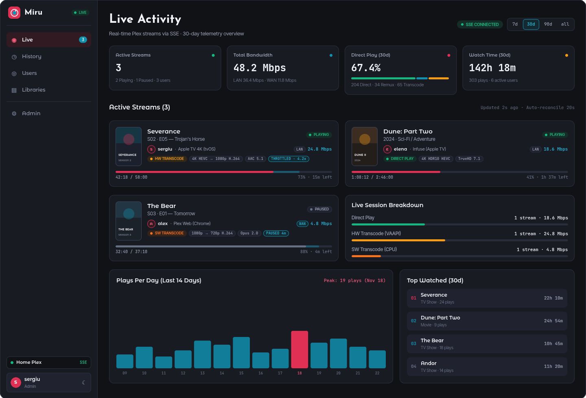
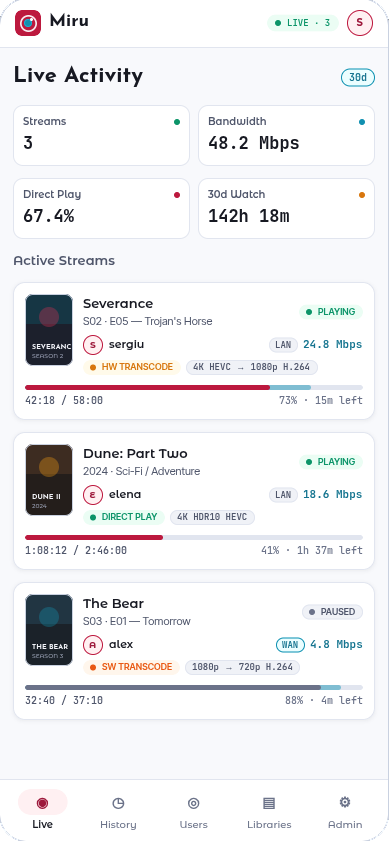

# Miru (見る)

Lightweight media server telemetry, live stream monitor, playback history tracker, and library stats engine.

Built with **Kotlin 2.4 / JDK 25**, **Ktor 3**, **Arrow-kt**, and dual **SQLite / PostgreSQL** persistence — exposing a versioned REST + SSE API (with OpenAPI 3.1 contract) for a decoupled frontend.

## Screenshots

### Desktop — Live Activity



### Mobile PWA — Dark & Light Themes

<p align="center">
  
  
</p>

## Development

Enable the `commit-msg` hook, which enforces [Conventional Commits](https://www.conventionalcommits.org/):

```sh
git config core.hooksPath .githooks
```

Copy `.env.example` to `.env` (git-ignored) and export your local settings, then run:

```sh
./gradlew check
./gradlew run
```

### Frontend (SvelteKit PWA)

The decoupled SvelteKit 2 + Svelte 5 + Tailwind CSS v4 PWA lives under [`web/`](web/) and consumes a generated TypeScript client from `src/main/resources/openapi/openapi.yaml`:

```sh
cd web
bun install
bun run api:gen   # regenerate TypeScript types from OpenAPI spec
bun run dev       # Vite dev server on :5173 (proxies /api, /healthz, /readyz to :8080)
bun run check     # svelte-check + TypeScript validation
bun run test      # Vitest unit tests
bun run build     # builds static PWA bundle into web/build
```

In Docker builds, `web/build` is bundled into `/opt/miru/static` and served automatically by Ktor (`STATIC_WEB_DIR=/opt/miru/static`) with SPA fallback and immutable asset caching.

## System Endpoints

- `GET /healthz` — liveness probe
- `GET /readyz` — readiness probe aggregating registered dependency checks
- `GET /api/v1/openapi.yaml` — OpenAPI 3.1 specification

## Authentication, RBAC & API Keys

Miru supports `AUTH_MODE=local` (default) and `AUTH_MODE=none` (local development bypass).

- **First-run setup & bootstrap**: Set `MIRU_ADMIN_USERNAME` + `MIRU_ADMIN_PASSWORD` (min 12 chars) to
  bootstrap an initial admin idempotently on startup, or call `POST /api/v1/auth/setup` once when
  `GET /api/v1/auth/status` reports `setupRequired: true`.
- **Session cookies**: `POST /api/v1/auth/login` and `POST /api/v1/auth/setup` issue an `HttpOnly; SameSite=Lax`
  HMAC-SHA256 signed `miru_session` cookie backed by hashed tokens in `auth_sessions`. `POST /api/v1/auth/logout`
  revokes the session and clears the cookie.
- **RBAC roles**: Accounts have role `ADMIN` or `USER`. `USER` accounts can be linked to specific Plex media
  user IDs (`PUT /api/v1/admin/accounts/{id}/media-users`) for downstream data scoping.
- **API keys**: Admins can manage keys via `/api/v1/admin/api-keys` (raw `miru_...` key returned once on
  creation; stored as SHA-256 hash). Authenticate requests using either `X-Api-Key: <key>` or
  `Authorization: Bearer <key>`.
- **Unauthenticated system endpoints**: `/healthz`, `/readyz`, and `/api/v1/openapi.yaml` remain public.

## Real-time Plex Monitoring

Miru keeps live sessions in sync with Plex through two complementary paths:

- **Notification socket** (`PLEX_WEBSOCKET_ENABLED`, default `true`): a WebSocket client on
  `ws(s)://<plex>/:/websockets/notifications` (token sent as the `X-Plex-Token` header) parses `playing`,
  `timeline`, and `activity` notifications. Bursts of `playing` events are debounced before the active sessions
  are re-fetched. Dropped sockets reconnect with exponential backoff (1s → 60s cap, full jitter), and every
  reconnect triggers an immediate re-fetch.
- **Fallback reconciler** (`PLEX_POLL_INTERVAL_SECONDS`, default `20`, minimum `5`): re-fetches active sessions
  whenever the interval elapses without a reconcile, catching clients that crash without emitting `stopped`.
  With `PLEX_WEBSOCKET_ENABLED=false` Miru runs in polling-only mode.

Both stop cleanly when the Ktor application shuts down.

## Container & Kubernetes Deployment

Build and smoke-test the container image locally:

```sh
docker build -t miru:local .
docker run --rm -p 8080:8080 \
  -e PLEX_URL=http://host.docker.internal:32400 \
  -e PLEX_TOKEN=your-plex-token \
  -e AUTH_MODE=none \
  miru:local
```

Ready-to-adapt Kubernetes Kustomize manifests live under [`k8s/`](k8s/README.md).

