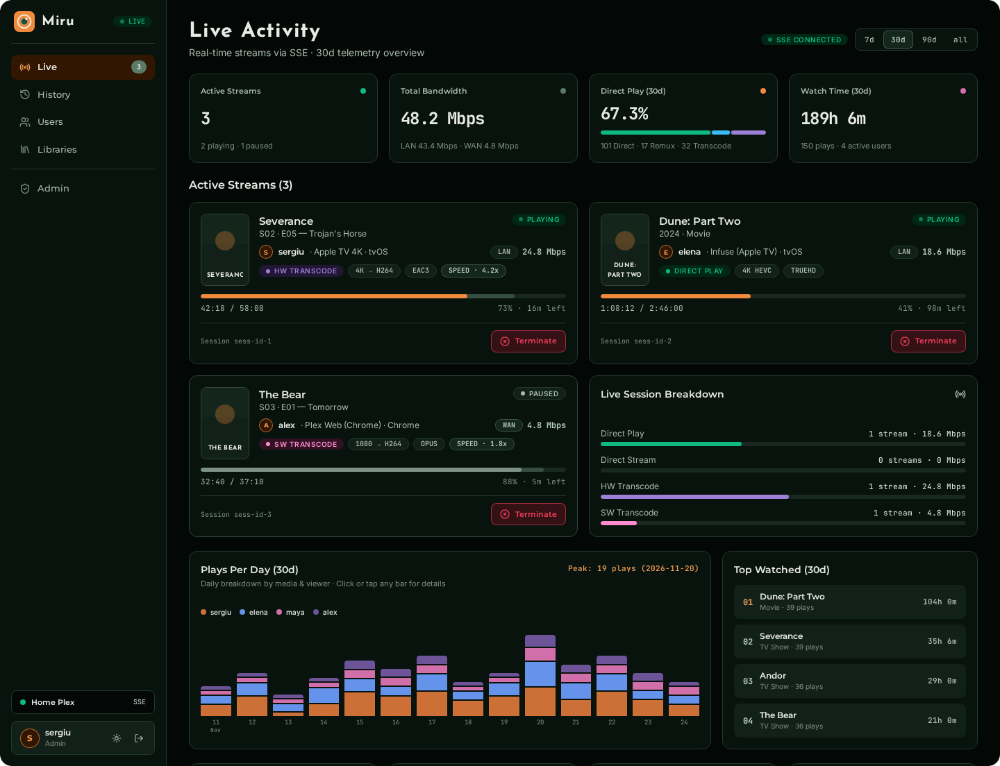
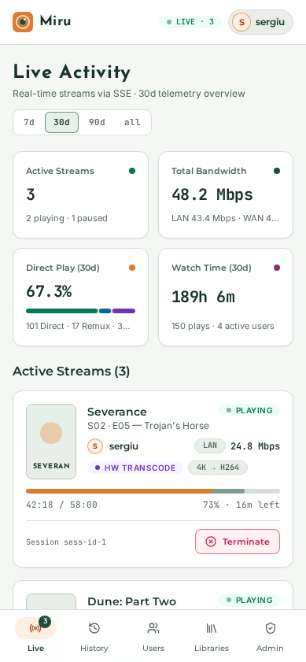

# Miru (見る)

Lightweight, security-hardened media server telemetry, live stream monitor, playback history tracker, and library analytics engine for Plex.

Built with **Kotlin 2.4 / JDK 25**, **Ktor 3**, **Arrow-kt**, and dual **SQLite / PostgreSQL** persistence — bundling a decoupled SvelteKit 2 + Svelte 5 PWA and OpenAPI 3.1 API into a **73.5 MiB** shell-less Distroless container.

## Screenshots

### Desktop — Live Activity



### Mobile PWA — Dark & Light Themes

<p align="center">
  
  
</p>

## Performance

Benchmarked side-by-side against **Tautulli v2.19.1** on a shared **10,000-play** dataset (`2 vCPU / 512 MiB` containers, Mock Plex HTTP + WebSocket server):

| Metric | Miru (SQLite) | Miru (PostgreSQL 17) | Tautulli (SQLite) |
| :--- | :---: | :---: | :---: |
| **Live UI update latency** *(start/pause/stop)* | **`526–532 ms`** *(WS + SSE)* | — | `9.5 s` *(10 s poll)* |
| **30s live traffic** *(3 active streams)* | **`1 SSE connection / 9.3 KiB`** | — | `3 reqs / 64.7 KiB` |
| **Cold-load transfer** *(browser, uncached)* | **`337.0 KiB`** *(Brotli `.br`)* | — | `504.2 KiB` *(gzip)* |
| **History p.1 (`c=10`, p50 / p99)** | `4.4 / 11.2 ms` (`2,057 req/s`) | **`3.7 / 12.5 ms`** (`2,354 req/s`) | `40.6 / 1,092.3 ms` (`173 req/s`) |
| **30d stats (`c=10`, p50)** *(cached)* | `2.8 ms` (`3,253 req/s`) | **`2.7 ms`** (`3,390 req/s`) | `350.2 ms` (`27 req/s`) |
| **All-time stats (`c=10`, p50)** *(cached)* | **`23.2 ms`** (`419 req/s`) | `24.4 ms` (`405 req/s`) | `1,032.0 ms` (`9 req/s`) |
| **Cached artwork (`c=10`, p50)** | **`0.81 ms`** (`9,632 req/s`) | — | `6.39 ms` (`1,550 req/s`) |
| **Cold start / 10k Tautulli import** | **`1.02 s`** / **`808 ms`** | `1.09 s` / `1.96 s` | `1.27 s` / — |
| **Image size (`amd64`, compressed / unpacked)** | `73.5 MiB` / **`187.4 MiB`** | `73.5 MiB` / **`187.4 MiB`** *(+ PG)* | **`72.8 MiB`** / `296.1 MiB` |

Miru delivers **18× faster live UI updates** with **6.9× less live traffic**, a **33% smaller cold-load wire transfer**, **14×–126× higher concurrent query throughput** on PostgreSQL (with API gzip active, and stats served from Miru's in-memory stats cache), **6.2× higher concurrent cached artwork throughput**, **20% faster cold startup**, and a **37% smaller unpacked Distroless image**. Tautulli keeps a smaller RAM footprint (`82 MiB` vs Miru's `171–198 MiB` JVM working set). See [`docs/benchmarks.md`](docs/benchmarks.md) for full methodology and trade-offs.

## Security

Miru isolates Plex credentials, sessions, and outbound fetches behind a hardened Ktor API boundary:

- **Auth, rate limiting & RBAC:** BouncyCastle **Argon2id** (`Semaphore(4)` concurrency cap, zeroized `CharArray`, constant-time timing parity), bounded per-IP/per-account rate limiting (`429` + `Retry-After`), proxy-aware `Secure` + `HttpOnly; SameSite=Lax` HMAC-SHA256 session cookies, native **OIDC (PKCE `S256`)** with asymmetric JWS allowlists and verified-email linking, SHA-256 hashed API keys, and fail-closed per-user & Plex library-section RBAC across history, stats, SSE, metadata, and artwork.
- **Zero Plex token exposure:** Plex OAuth tokens and outbound webhook secrets are encrypted at rest with **AES-256-GCM** (`MIRU_ENCRYPTION_KEY`); `PLEX_TOKEN` stays server-side, secrets are redacted in logs/`toString()`, and errors return RFC 7807 Problem Details without stack traces.
- **Headers, SSRF & parser hardening:** Global HTTP security headers (`nosniff`, `DENY`, strict API/SPA **CSP** with startup SHA-256 script hashes), DNS public-IP validation + socket-pinned HTTPS avatar proxy (blocking private/metadata IPs & DNS rebinding), SSRF-filtered **HMAC-SHA256** outbound webhooks, XXE-disabled XML parsers, and 256 MiB capped read-only Tautulli SQLite imports.
- **Distroless & supply-chain gates:** Digest-pinned shell-less **`distroless/base-nossl-debian13:nonroot`** + 14-module `jlink` JRE (`UID 10001`), read-only rootfs with `--tmpfs /tmp:noexec,nosuid,nodev`, Kubernetes `restricted` PSS + `NetworkPolicy`, blocking **Trivy** `CRITICAL,HIGH` CVE gate, CodeQL `security-extended`, SHA-pinned Actions, and **GitHub Artifact Attestations**.

See [`docs/security.md`](docs/security.md) for the complete source-verified security profile.

## Quick Deployment

Multi-arch (`amd64`, `arm64`) images are published at [`ghcr.io/hononeko/miru`](https://github.com/hononeko/miru/pkgs/container/miru) (port `8080`, SQLite in `/data` or PostgreSQL via `DB_ENGINE=postgres`).

### Docker Compose

Copy [`docs/docker-compose.yml`](docs/docker-compose.yml) into an empty directory, generate two 32+ char secrets, and start:

```sh
cat > .env <<EOF
AUTH_SESSION_SECRET=$(openssl rand -base64 48)
MIRU_ENCRYPTION_KEY=$(openssl rand -base64 48)
EOF
docker compose up -d
```

Open <http://localhost:8080>, complete first-run admin setup, and connect Plex from **Admin** (or set `PLEX_URL` + `PLEX_TOKEN`).

### Kubernetes & Configuration

- **Kubernetes:** `helm install miru oci://ghcr.io/hononeko/charts/miru` installs the [Helm chart](charts/miru/README.md), published with every release, with `restricted` PSS defaults and optional Gateway API `HTTPRoute`, Ingress, `NetworkPolicy`, `ServiceMonitor`, and Grafana dashboard.
- **Configuration:** Every setting is documented with defaults and validation rules in [`docs/environment-variables.md`](docs/environment-variables.md).
- **Real-time Plex sync:** Subscribes to Plex's WebSocket notification stream (`PLEX_WEBSOCKET_ENABLED=true`) with debounced updates, jittered reconnect backoff, and a fallback reconciler (`PLEX_POLL_INTERVAL_SECONDS=20`), pushing live updates to browsers over SSE.
- **API & webhooks:** [`docs/compatibility.md`](docs/compatibility.md) lists what stays compatible between releases, and [`docs/webhooks.md`](docs/webhooks.md) describes the webhook payloads and signature.
- **Kometa & Tautulli API:** Kometa and similar tools can read from Miru instead of Tautulli, see [`docs/tautulli-api.md`](docs/tautulli-api.md).
- **Prometheus & Grafana:** Set `METRICS_ENABLED=true` to expose Prometheus metrics at `GET /metrics` (default port `9090`); see [`charts/miru/templates/servicemonitor.yaml`](charts/miru/templates/servicemonitor.yaml) and [`docs/grafana/miru-dashboard.json`](docs/grafana/miru-dashboard.json).
- **System endpoints:** `GET /healthz` (liveness), `GET /readyz` (readiness), `GET /metrics` (opt-in Prometheus metrics), `GET /api/v1/openapi.yaml` (OpenAPI 3.1 contract).

## Development

```sh
git config core.hooksPath .githooks   # enforce Conventional Commits
cp .env.example .env                  # configure local environment
./gradlew check && ./gradlew run      # backend checks & server on :8080
```

The SvelteKit 2 + Svelte 5 PWA lives in [`web/`](web/):

```sh
cd web
bun install
bun run api:gen   # regenerate TypeScript client types from OpenAPI spec
bun run dev       # Vite dev server on :5173 (proxies /api, /healthz, /readyz to :8080)
bun run check && bun run test && bun run build
```

Build and smoke-test the container locally:

```sh
docker build -t miru:local .
docker run --rm -p 8080:8080 --read-only --tmpfs /tmp:noexec,nosuid,nodev \
  -e PLEX_URL=http://host.docker.internal:32400 \
  -e PLEX_TOKEN=your-plex-token \
  -e AUTH_MODE=none \
  miru:local
```
